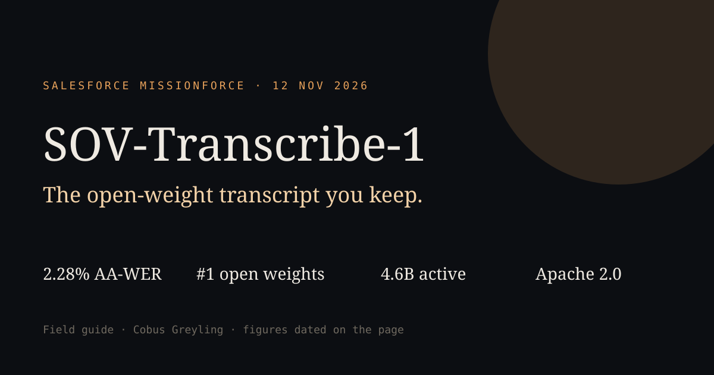

<p align="center">
  
</p>

# SOV-Transcribe-1 — a field guide

Salesforce released [SOV-Transcribe-1](https://huggingface.co/salesforce-sovereign-intelligence/SOV-Transcribe-1) on 12 November 2026. It is an open-weight speech model for a recording you already have. The weights are Apache 2.0. You can run them on infrastructure you control.

This repository is an independent reading of that release: the architecture, the benchmark table, the prompts, and the machine it actually needs. It is not a Salesforce product. The weights are not in git. Nothing here is a live transcript from the model.

**Open the guide → [`index.html`](index.html)** · published at <https://cobusgreyling.github.io/sov-transcribe-1/>

**Read the essay → [`BLOG.md`](BLOG.md)** · **Check a number → [`SOURCES.md`](SOURCES.md)**

## The shape of it

| | |
| --- | --- |
| Kind | Non-streaming speech recognition. A file goes in. Text comes out. |
| Size | 26.6B parameters, 4.6B active, including the audio encoder |
| Stack | Whisper large-v3 encoder, a projector, Gemma 4 26B A4B |
| Languages | English, French, German, Spanish, Italian, Portuguese, Dutch |
| Length | Up to 30 minutes in Salesforce’s tests |
| Control | A plain-language instruction, plus names or a topic |
| Licence | Apache 2.0 |
| Board | 2.28% AA-WER. #1 open weights and #7 overall on Salesforce’s 12 Nov table |

The 2.28% is a weighted average, and the weights are public. Half is voice-agent talk (1.78), a quarter is parliamentary speech (1.50), a quarter is earnings calls (4.06). On agent talk it ties Nemotron 3.5 Transcribe. The lead is the other two sets.

Artificial Analysis, retrieved 13 November 2026, still lists it as the most accurate open-weights model, at a rounded 2.3%. Hosted systems on that page sit lower, from 1.7% up. The guide keeps those dates apart.

## Where a buyer should look twice

The launch table is kind on entities, accents, and noisy earnings audio. It is unkind on the multilingual mean (4.88, behind Voxtral Small at 3.39), on ContextASR once a fine entity list is supplied, and on clean financial read-speech. Dutch is the weak language in the published set, at 7.67% word error. The model card does not offer speaker labels or a live stream.

VoiceCodeBench is the number that matches a voice agent. A recording passes only when every target entity is correct. SOV passes 76.33% of them and recovers 93.39% of the entities. One wrong digit still fails the task.

## Run it

The practical path on launch day was the vLLM plugin in the model repository, which installs vLLM 0.32.0. Native support was still being upstreamed. Serving numbers were measured on one 96 GB RTX PRO 6000 Blackwell. Holding the BF16 weights is on the order of 53 GB before cache. That last figure is arithmetic, not a Salesforce measurement.

```bash
hf download salesforce-sovereign-intelligence/SOV-Transcribe-1 \
  --include "vllm_plugin/*" --local-dir SOV-Transcribe-1
pip install ./SOV-Transcribe-1/vllm_plugin
vllm serve salesforce-sovereign-intelligence/SOV-Transcribe-1 --max-model-len 32768
```

The [notebook](notebooks/sov_transcribe_1.ipynb) builds the request and stops before any download unless you set `RUN_MODEL = True` on a CUDA machine.

[](https://colab.research.google.com/github/cobusgreyling/sov-transcribe-1/blob/main/notebooks/sov_transcribe_1.ipynb)

## Layout

```
index.html          the guide
benchmarks.js       the launch table, one copy
app.js              table, bars, prompts, fit check
BLOG.md             the essay
SOURCES.md          links behind the numbers
notebooks/          request builder, inference off by default
check_sources.py    arithmetic check on the index
```

```bash
python3 check_sources.py
```

## Licence

Notes in this repository are Apache-2.0. The Salesforce weights are Apache-2.0 and live on Hugging Face, not here.
